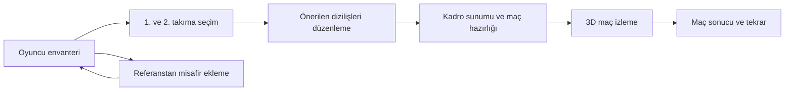

# Alsancak v1 — Mimari

Durum: **mimari, oyuncu envanteri/puanlama ve misafir/profil/kayıt adımları hazır.** Referanstan oluşturma, genel/iki yüzde çubuğu, canlı önizleme, IndexedDB ve ortak profil mevcut görünüme bağlandı. Takım seçimi, öneriler ve maç motoru sonraki adımlardır.

## 1. Kullanıcı akışı



### Ekran 1: takım seçimi

- Solda **1. takım** ve **2. takım** blokları; sağda oyuncu envanteri, arama, mevki filtresi ve **Oyuncu ekle**.
- Bir takım bloğuna tıklamak onu aktif yapar. Envanterdeki oyuncuya her tıklama o takıma ekler. İlk ekranda sürükleme yoktur.
- Seçilmiş oyuncular envanterde hangi takımda olduklarıyla gösterilir; aynı oyuncu iki takıma eklenemez. Diğer takımdaki oyuncu sessizce taşınmaz.
- Takım içindeki kaldırma düğmesi oyuncuyu çıkarır. Envanterde bilgi düğmesi profil açar; ekleme tıklamasından ayrıdır.
- Her takım 11 kişiyle sınırlı. Devam için iki takım da 11 kişi ve en az bir **gerçek kalecilik puanına sahip kaleci** içermeli. Saha oyuncusunun GK uygunluğunun yüksek olması tek başına kaleci ratingi üretmez.
- İsimler düzenlenebilir; kimlikler isimden bağımsızdır. Takım seçimi otomatik kaydedilir.
- `Dizilişleri öner` ikinci ekrana geçer. İlk ekran takım dengesini oyuncu değiştirerek kendiliğinden bozmaz.

### Ekran 2: diziliş ve kadro inceleme

- İki ayrı taktik saha, takım başına diziliş seçimi ve alternatif öneriler.
- Başlangıç dizilişleri: **4-2-3-1, 4-3-3, 4-4-2, 3-5-2, 5-3-2**. Yeni diziliş bir konfigürasyon kaydı eklenerek genişler.
- Sistem önce her dizilişe oyuncu-mevki ataması yapar. Tekil rol puanlarıyla başlangıç eşleştirmesi, sonra kimya ve bağlantılar için yer değişimi araması kullanılır. İki takım rakip eşleşmeleriyle birlikte değerlendirilir.
- Bu bir açıklanabilir öneridir; matematiksel olarak küresel en iyi kadro garantisi verilmez.
- Diziliş değişince mevcut oyuncular korunarak tekrar atanır. Elle yapılan tercih mümkün olduğunca korunur; yeni formasyonda karşılığı yoksa uygun boş slota taşınır ve gösterilir.
- Aynı takımda oyuncular sürükle-bırakla slot değiştirir. Klavye/dokunmatik için iki slotu sırayla seçme seçeneği aynı `swap-slots` komutunu çalıştırır.
- Oyuncuya normal tıklama profil açar; sürükleme eşik mesafesini aşarsa profil açılmaz. İki takım arasında taşıma için ilk ekrana dönülür.
- **Rol gücü, pas bağlantısı, uyum, savunma dengesi, hücum tehdidi** skorları her değişiklikte iki takım için birlikte güncellenir. Değişiklik nedeni oyuncu isimleriyle açıklanır.
- Görsel skorlar 0–100 gösterge değerleridir. Kazanma yüzdesi değildir; genel kimya skoru bütün özelliklere otomatik bir sayı olarak eklenmez.
- Her taslak değişikliğinin `revision` değeri artar. Eski öneri veya hesap sonucu yeni taslağın üzerine yazılamaz.

### Ortak oyuncu profili

- FM referansına göre koyu lacivert başlık, antrasit paneller ve altın vurgu; gereksiz emoji kullanılmaz.
- Profil, envanter kartları ve misafir önizlemesinde özellikler **20 üzerinden tam sayı** gösterilir: temel özellik/uygunluk `round(değer × 2)`, mevki ratingi `round(rating / 5)`. Hesaplama/kayıt katmanındaki özgün puan ölçekleri ve iki ondalıklı hassasiyet korunur.
- Özellik göstergeleri 16–20 yeşil, 10–15 sarı, 1–9 kırmızı; özellik çubukları yoktur. Rol seviyesi mutlak mevki puanından türetilen beş yıldız ve yarım yıldızlarla gösterilir. Yıldızlar takım kadrosuna göre değişen göreli bir değerlendirme değildir.
- İsim, ana/alternatif roller, 12 temel özellik, 7 mevki uygunluğu, hesaplanmış rol puanları; kaynaklı güçlü/zayıf yönler ve kimya notları.
- Özellikler fiziksel, teknik, zihinsel ve savunma olarak gruplanır. Baz değer ile o kadrodaki/maçtaki efektif değer ayrı gösterilir; farkın kaynağı açıklanır.
- Misafirlerde `Baran referansı · %95 · tahmini profil` benzeri kaynak bilgisi görünür.
- Kalecide mevcut tek kalecilik puanı gösterilir; olmayan refleks/ayakla oyun/12 saha özelliği uydurulmaz.
- Yaş, uyruk, gerçek portre gibi arşivde olmayan alanlar eklenmez. Forma/sade siluet yeterlidir.
- Paylaşılan modal; Escape, kapatma, odak geri dönüşü ve dar ekranda kendi içinde kaydırma.

## 2. Misafir oyuncu modeli

### Oluşturma

1. Envanterden referans oyuncu seç.
2. İsim gir.
3. `Genel` veya `Ayrı ayarla` modunu seç.
4. Canlı özellik ve rol puanı önizlemesini gör; **Kaydet** ile envantere ekle.

Başlangıç %95, aralık %60–%120. Genel mod 12 temel özelliğin tamamını aynı yüzdeyle çarpar. Ayrı modun kapsamı açıkça gösterilir:

| Çubuk | Kapsanan özellikler |
| --- | --- |
| Fiziksel | HIZ, DAY, GÜÇ |
| Teknik / oyun | PAS, GÖR, KNTRL, DRİB, ŞUT, BİT, DEF, PRES, POZ |

İkinci çubuğun geniş adı kasıtlıdır: iki çubuk toplam 12 özelliğin tamamını kapsar; zihinsel/savunma değerleri gizlice sabit bırakılmaz. Profil ekranındaki daha ayrıntılı dört grup bu düzenlemeden bağımsızdır.

- Örnek: Baran'ın PAS 8.5 değeri %95 ile **8.08** baz değere dönüşür. Önce çarpılır, 1–10 aralığına alınır, iki ondalığa yuvarlanır. Kullanıcının son tercihi gereği türetilen özellikler ve ratingler iki ondalıkla saklanır/gösterilir.
- Stage 1 mevki uygunlukları ve referansın rol tercihleri kopyalanır; yüzdeyle çarpılmaz. Altı rol ratingi yeni özelliklerden formülle hesaplanır.
- Kaleci referansında tek genel yüzde kullanılır; 0–100 kalecilik puanı ölçeklenir, çift çubuk modu kapatılır.
- Her kayıtta yeni ID oluşur. Referans ID'si ve sürümü provenance olarak saklanır; referansın ileride değişmesi mevcut misafiri değiştirmez.
- Referansın isim bazlı çift/üçlü kimyaları, kişilik tetikleyicileri ve haftalık formu kopyalanmaz. `Baran gibi` demek Baran–Eren bonusuna ortak olmak değildir.
- Kaydetmek envantere ekler; aktif takıma eklemek ayrıca bir tıklamadır. Çifte kaydetmeye karşı işlem sürerken düğme kilitlenir.
- Misafir arşivlenebilir; eski maçlar kendi snapshot'larıyla korunur.

### Sürekli başlangıç uyum dezavantajı

Bu değerler **ilk ayar önerisidir**; gerçek maç motoru ve toplu denemelerle ölçülerek kalibre edilir. Mevcut provada uygulanmaz.

| Etki | Başlangıç ayarı | Uygulandığı yer |
| --- | --- | --- |
| Pas seçeneği olarak ağırlık | ×0.94 | Pas atan oyuncunun aday değerlendirmesi; adaylar normalize edilmeden önce |
| Koordinasyon | PAS −0.3, GÖR −0.3, POZ −0.2 | Yalnızca maçlık efektif özellikler |
| İlk dokunuş hatası | Temel hata ihtimali ×1.08; ek artış en fazla 3 yüzde puanı | Kontrol/baskı/servis kalitesinden hesaplanmış hata ihtimali üzerine bir kez |

Hata formülü: `p = min(1, p0 × 1.08, p0 + 0.03)`. Örneğin normal hata olasılığı %10 ise %10.8 olur; doğrudan +8 yüzde puanı eklenmez. Güçlü oyuncu hâlâ iyi kontrol eder; düşük kontrol ve baskı altında hata daha görünür olur.

Pas seçilme ağırlığının %6 azalması, toplam pas sayısının tam %6 azalacağını garanti etmez. Oyuncunun boşluğu ve kalitesi yine belirleyicidir. Pas yasağı veya rastgele zorunlu top kaybı uygulanmaz. Tüm etkiler farklı aşamalardadır; aynı resepsiyon için aynı ceza iki kez sayılmaz.

Bu uyum katmanı misafir kaldığı sürece her maçta aktiftir; haftalık form pozitif olsa da otomatik silinmez. Kalecide uydurma PAS/GÖR değerleri yerine pas dağıtımı/iletişim aşamasına uygulanır; kalecilik kurtarış puanı doğrudan düşürülmez. Sınırlar `GUEST_POLICY` içinde sürümlenir.

## 3. Katmanlar ve bağımlılık yönü

```text
features (ekranlar) → application (akış / komutlar) → domain (sözleşmeler)
                             ↓ servis arayüzleri
                 data adapters / workers / rendering

engine → domain + sürümlü konfigürasyon
rendering → MatchFrame + MatchSnapshot
```

| Dizin | Sorumluluk | Bu turdaki içerik |
| --- | --- | --- |
| `src/v1/domain` | Oyuncu, takım, modifier, maç ve tekrar veri modelleri | Tip sözleşmeleri ve uygulanmış iki ondalıklı puanlama |
| `src/v1/config` | Misafir, simülasyon, skor, kamera politikaları ve 5 diziliş | Tip kontrolünden geçen başlangıç ayarları |
| `src/v1/data` | Kaynak aktarımı, envanter, form ve kayıt depoları | Uygulanmış importer, JSON doğrulama, salt okunur envanter/arama; yazma depoları arayüzleri |
| `src/v1/application` | Ekran akışı, seçim/diziliş komutları, snapshot oluşturma | Servis ve durum geçiş sözleşmeleri |
| `src/v1/features` | Altı ekran/ortak pencerenin ihtiyaçları ve kullanıcı niyetleri | View model / intent sözleşmeleri |
| `src/v1/engine` | Kararlar, kurallar, maç hesaplama | Motor/karar/modifier arayüzleri |
| `src/v1/workers` | Arka plan öneri/simülasyon haberleşmesi | Tipli istek/cevap protokolü |
| `src/v1/rendering` | 3D sahne, otomatik/elle kamera, isimler | Kamera ve sahne adaptör sözleşmeleri |

Yeni kod TypeScript ile yazılacak. Onaylanmış JS görüntüleyici, entegrasyon adımında bu sözleşmelere adapte edilecek. Şimdiden ikinci bir 3D sahne veya yeni bir UI framework'ü eklenmez. Uygulanmamış servisler üretim girişine bağlanmaz.

## 4. Oyuncu verisinin aktarılması

- Birleşik Markdown tek kaynak arşivi olarak korunur. Build-time aktarım betiği **48 oyuncu / 43 saha oyuncusu / 5 kaleci**, tüm özellikler, uygunluklar, ana roller ve kaynak notları için sürümlü JSON üretir.
- Çalışan uygulama Markdown tablolarını her açılışta ayrıştırmaz.
- Kimlikler sabittir; isim normalleştirmesi sadece arama içindir. Kurallar isim karşılaştırmasıyla değil ID ile eşleşir.
- 258 saha mevki puanı kaynaktaki %92 Stage 2 / %8 Stage 1 formülü ve ara uygunluk interpolasyonuyla doğrulanır. Ana rol otomatik en yüksek skor olarak değiştirilmez.
- Kullanıcının son tercihi gereği mevki puanları **iki ondalıkla yeniden hesaplanır**. Ömer stoper **75.05**, Onur CAM **69.55**, Altuğ CB **60.05** olur. Kaynakların tek ondalıklı gösterimleri ±0.05 payla doğrulanır. PDF/Excel gösterimleri ve farkları arşivde/aktarım raporunda korunur; kaynak değiştirilmez.
- Kaleci verisi ayrıdır. Kaynakta olmayan kaleci özellikleri türetilmez.
- Kural aktarımı ayrıca sürümlü kimya/kişilik profilleri ve koşul kayıtları üretir. Serbest metin notları doğrudan çalıştırılabilir koda dönüştürülmez.

## 5. Kimya, haftalık form ve efektif değerler

Kalıcı oyuncu kaydı + haftalık form kaydı + kadro/eşleşme + anlık maç bağlamı → efektif özellikler ve neden defteri.

- `WeeklyForm` oyuncu ID'si, hafta ve sürümle ayrı saklanır. İlk sürümde boş form listesiyle çalışır; ileride form ekranı aynı sözleşmeyi doldurur.
- Çift/üçlü bonuslar, atmosfer, rakip eşleşmesi, yorgunluk, skor ve misafir uyumu ayrı katmanlardır.
- Baran–Eren ve üçlü bonus aynı dışlama grubunda; aynı bonus iki kez uygulanmaz.
- Negatif kişilik riski kadroda bulunmakla otomatik aktifleşmez; davranış koşulu gerekir. Misafir uyum cezası bunun dışındaki açık ve sürekli bir kuraldır.
- Modifiers ledger her etkiyi `ruleId`, oyuncular, neden ve etkiyle taşır. Profil, takım puanı ve pozisyon açıklaması aynı kural motorunu kullanır.
- PAS/GÖR çevresi, clutch, servis alamama gibi nitel koşulların kesin eşikleri, uygulama adımında sürümlü predicate konfigürasyonuna yazılır; renderer bu kararları vermez.

Arşivde açık bırakılan konular için ilk uygulama kararları (`RULEBOOK_DECISIONS`):

1. Baz özellikler 1–10; kilitli etkilerin efektif 10 üstü değerleri korunur (Ömer PRES 11 gibi). Olasılık dönüşümleri her durumda 0–1 aralığını korur.
2. Normal özellik bonusları +1 / cezaları −1 sınırında, kilitli kurallar ve faza özel doğrudan değer atamaları daha yüksek öncelikte. Aynı bonus farklı kaynak satırlarında tekrar ediyorsa bir kez sayılır.
3. Eren'in çevre bonusu üçlü bonusuyla normal özellik tavanı içinde birleşebilir; Baran–Eren ikili bonusu üçlüyle birleşmez.
4. Atmosfer eşiklerinden önce takım başına en fazla bir hafif negatif kaynak güçlü stabilizatörle dengelenir. Güçlü negatif ve Arif–Barkuz kilitli cezası böyle iptal edilmez.
5. Evrensel `kimya skoru → bütün özellikler` dönüşümü eklenmez; arşivin isim bazlı etkileri uygulanır.

Bu kararlar kaynak iddiası değildir; motor uygulaması için açıkça kayda alınmış tercihlerdir. Kalıcı veri ve eski maç kayıtları sonradan değişmez.

## 6. Maç motoru ve gösterimin ayrılması

- Maç başlatılırken 22 oyuncu, iki diziliş, o haftaki form, kural kararları, seed ve sürümler **değişmez bir `MatchSnapshot`** olur.
- Motorda 50 Hz sabit zaman adımı, karar değerlendirmesinde 5 Hz, top için tick başına iki fizik alt adımı başlangıç bütçesidir. Bunlar performans ölçümünden sonra kalibre edilir.
- Oyuncuların koşu/savunma/toplu ve topsuz kararları saha koordinatlarında hesaplanır. Render FPS'i veya oynatma hızı kararı/sonucu değiştirmez.
- Nitelikler eylemlerde birlikte değerlendirilir: uzun pas PAS/GÖR ve koridor açıklığı; kontrol KNTRL ve baskı; koşu HIZ/DAY; şut ŞUT/BİT, açı/mesafe/kaleci; savunma DEF/PRES/POZ/GÜÇ.
- Topun varış noktası, uçuşu, sapması ve oyuncunun oraya yetişmesi motor çıktısıdır. Görüntüleyici sonuca göre rastgele hareket uydurmaz.
- Hata ihtimalleri her render karesinde yeniden atılmaz; eylem başında veya simülasyon süresine bağlı hazard ile değerlendirilir.
- `Math.random`, duvar saati, DOM ve kamera motora girmez. Tek run'a ait seed'li PRNG kullanılır.
- V1 olayları: pas, ara/çapraz pas, kontrol, kötü dokunuş, anlaşmazlık, koşu, müdahale, pas arası, şut, kurtarış, gol ve temel duran top/ofsayt olayları. Ayrıntılı sakatlık/transfer/sezon yönetimi v1 dışında.

### Skor kalibrasyonu

Kullanıcının örnekleri: 4–2, 4–3, 4–4, 5–5, 7–5, 9–7, 11–7, uç örnek 16–0; 3–3 de mümkün. Başlangıç hedef medyan toplam gol 12; kesin kural değildir. Maç süresi, hücum sayısı, savunma baskısı ve bitiriş olasılıkları toplu seed'li maçlarla ayarlanacak.

Skor önce seçilip ona ulaşmak için olaylar yazılmaz. Minimum gol veya 16–0 tavanı zorlanmaz. Dengeli ve belirgin dengesiz kadrolar ayrı test edilir; şut/pas/kurtarış sayılarıyla sonuçların oluşumu denetlenir.

## 7. Hazırlık, Worker ve tekrar verisi

- Kadro sunumu/sahaya çıkış başlarken simülasyon Web Worker'da başlar. Arayüz ve 3D hareketler hesaplamayla bloke olmaz.
- Giriş sunumu biter ama maç hazır değilse gerçek aşama/ilerleme gösterilir. Sunum atlanabilir; hazır olmayan maç başlatılmaz. Simülasyon erken biterse gereksiz yapay bekleme eklenmez.
- `runId`, `matchId`, taslak revizyonu ve sürümler birlikte taşınır. Geri dönme/iptal eski worker sonuçlarının yeni maça yazılmasını engeller.
- 10 Hz snapshot, 30 saniyelik ikili buffer parçaları; sonradan ara kareler interpolate edilir. 90 dakikanın ham pose+top verisi yaklaşık 40 MB düzeyindedir; state/olay/metadata ve tarayıcı ek maliyetleri bunun dışındadır. Tek dev JSON ve render store'una 50 Hz durum basılması kullanılmaz.
- Buffer aktarımı transfer listesiyle; küçük bir pencere kadar chunk sırada tutulur. `chunk-persisted` ack ile yazma hızı kontrol edilir.
- Tamamlanan parçalar IndexedDB'ye yazılır. Manifest **bütün parçalar doğrulanıp kaydedilince** complete olur; worker'ın complete mesajı tek başına izleme izni değildir.
- Depolama kotası/yazma hatası görünür hata durumuna geçer; taslaklar korunur. Eksik kayıt başarı gibi gösterilmez.
- Tekrar, zaman çizelgesinden en yakın indeksli parçaya gider; buffer hazır değilse playback buffering olur. Gol sonrası santra/devre değişimi gibi kesintiler üzerinden yanlış interpolasyon yapılmaz.
- Pozisyon nedenleri olay kaydındadır. Yavaşlatma, hızlandırma, geri sarma veya kamera değiştirme aynı maçın sonucunu değiştirmez.

## 8. Kamera ve isimler

### Otomatik + elle ayar

- Varsayılan **otomatik takip**: top ve aktif pozisyonun odağına yumuşak hareket. Hücum uzak kaleye ilerledikçe kadraj o bölgeye taşınır ve yaklaşır. Devre değişiminde hücum yönü frame verisinden alınır.
- Kullanıcı sol sürüklemeyle açı/yüksekliği, tekerlek/pinch ile yakınlığı ayarlar. Bu ofsetler otomatik takipte korunur; kamera kendiliğinden kullanıcı açısını sıfırlamaz.
- Sağ sürükleme/iki parmak pan serbest moda geçirir. **Otomatik takibe dön** düğmesi takip modunu yeniden açar.
- Yayın, geniş ve kale arkası presetleri korunur. Yükseklik/mesafe sınırları zeminin altına girmeyi engeller. Ani uçan top için kamera her top titreşimini birebir takip etmez.
- Kamera yalnızca presentation delta ile güncellenir; maç saati ve seed'e etkisi yoktur.

### Bağlamsal isimler

- En fazla beş: top sahibi, alıcı/koşucu, en ilgili presçi/ikili mücadele ve yakın destek önceliği.
- Orta saha mücadelesinde ilgili orta sahalar, hücumda hücumcular ve karşılayan savunmacılar.
- Kaleciler topu tuttuğunda veya gol yedikten sonraki üç saniye; uzaktaki kaleci adı sürekli görünmez.
- İsme öncelik, ekranda yerleşim ve HUD çakışmaları renderer tarafından çözülür; tüm oyunculara aynı anda ad basılmaz.

## 9. Kayıt ve yeniden üretilebilirlik

- İlk sürüm tarayıcıda yerel IndexedDB kullanır. Misafirler, taslaklar, haftalık form, maç snapshot'ları ve replay parçaları ayrı depolardır. Yeni bir sunucu hesabı bu aşamada gerekmez.
- Şema sürümü ve migration planı zorunludur. Basit kamera/UI tercihleri küçük tercih kaydında; büyük replay'ler localStorage'a konmaz.
- Maç kaydı seed, motor sürümü, veri sürümü, tuning sürümü ve kullanılan snapshot'ı taşır. Yeni oyuncu puanları eski maç kaydını değiştirmez.
- Tam byte eşitliği aynı motor sürümü/aynı çalışma ortamı için hedeflenir; farklı JS motorları arasında kayan nokta eşitliği vaat edilmez. Kayıtlı replay her ortamda aynı olay akışını oynatır.
- İleride dışa/içe aktarma ve yedekleme repository katmanına eklenebilir. JSON importu şema doğrular; notlar HTML/JS olarak çalıştırılmaz.

## 10. Uygulama sınırı ve doğrulama

Envanter aktarımı/puanlama ve misafir oluşturma/yerel kayıt/profil uygulanmıştır. `src/main.js` görsel provayı ve üst menüden oyuncu kütüphanesini açar. Kaynak oyuncular salt okunur; misafirler IndexedDB'den birleştirilir. Takım seçim ekranı, otomatik/elle kamera, öneri algoritması, motor ve worker giriş noktaları ilgili adımda uygulanıp bağlanacaktır.

Kontroller: `npm run check:architecture`, `npm run check:catalog`, `npm run test:catalog`, `npm run test:guests`, `npm run build`. Aktarım: `npm run import:catalog`. Sonraki adımlar ve kabul ölçütleri: [implementation-roadmap.md](implementation-roadmap.md).
